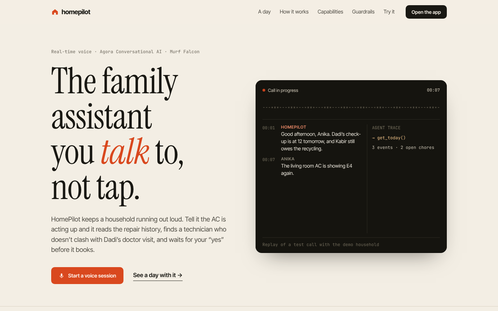

# HomePilot: the voice assistant that runs the family's day

> **Build with Agora, Bengaluru 2026** · Track **PS-1: Real-Time Conversational AI Meets Agentic Workflows** (AI Family Assistant)
>
> 🌐 **Live:** [fieldpilot-gu0j.onrender.com](https://fieldpilot-gu0j.onrender.com) · 🎙 **App:** [fieldpilot-gu0j.onrender.com/app.html](https://fieldpilot-gu0j.onrender.com/app.html) · 📞 **Join a family call:** [/expert.html](https://fieldpilot-gu0j.onrender.com/expert.html)
>
> 🎥 **Demo video:** [add link] · 📊 **Pitch deck:** [add link] · 👥 **Team SpeakX:** Lalit Kumar Singh

Anika just **talks**. HomePilot knows the family's calendar, chores and preferences. When the
living-room AC throws error E4 for the third time, it spots the repeat fault, walks her through a
safe check from the manual, finds a technician slot that **doesn't clash with Dadi's doctor visit**,
books it **only after she says yes**, puts it on the family calendar with a reminder, adds groceries
to the shopping list, asks Rohan to pick them up, reminds Dadi about her BP tablet, ticks off
Kabir's chore and sends everyone an update. It can even bring Rohan into the live voice call.

## Try it live

| Page | Link | What you'll see |
|---|---|---|
| Website | [https://fieldpilot-gu0j.onrender.com](https://fieldpilot-gu0j.onrender.com) | Call replay with waveform and agent trace, the “A day in the Sharma home” carousel, a live text console wired to the real agent, and the guardrails demo |
| Voice app | [https://fieldpilot-gu0j.onrender.com/app.html](https://fieldpilot-gu0j.onrender.com/app.html) | Tap the mic and talk: live family dashboard with calendar, chores, shopping list, reminders and the family channel |
| Family call | [https://fieldpilot-gu0j.onrender.com/expert.html](https://fieldpilot-gu0j.onrender.com/expert.html) | What a family member opens from Slack to join the live call |
| Health check | [https://fieldpilot-gu0j.onrender.com/api/diag](https://fieldpilot-gu0j.onrender.com/api/diag) | Models, voice settings and public URL status |

Hosted on Render's free plan: the first visit after a quiet period takes about 50 seconds to wake up. Click **Reset demo** in the app to start from the demo household.




## How it meets the problem statement

| PS-1 asks for | HomePilot |
|---|---|
| **Before:** retrieve schedules, pending tasks, preferences | `get_today` + a spoken **daily briefing** when the call starts: calendar, open chores, reminders, shopping list, household preferences (vegetarian, budget, quiet hours, Dadi's medicine) |
| **During:** understand priorities, coordinate by conversation | Contextual memory every turn (family, active issue, pending approvals). Appliance help from the **owner's manual (RAG)** plus **repeat-fault detection** from service history |
| **Action:** calendars, shopping lists, tasks, service requests via APIs | `find_service_slots` checks technicians **against the family calendar and quiet hours**; `book_service` (needs a spoken yes); `add_event`, `add_to_shopping_list`, `assign_task` (notifies the person on Slack) |
| **Shopping, end to end** | `add_to_shopping_list`, `mark_bought`, `remove_from_shopping_list`, `shopping_status` (estimated total), `order_groceries` (home delivery slot that avoids the calendar, needs a yes). Rohan gets a **live list on his phone** (`/list.html`) and ticks items in the store; when the last one is ticked his pickup task completes and the family is told |
| **Ordering by voice over MCP** | “Order a veg biryani” → `store_search` → `store_add_to_cart` → `store_checkout` reads back items, total and time → **“yes”** → the store requests payment and **you approve it on your phone** (QR on the dashboard, `/pay.html`) → live status: preparing, on the way, delivered, announced in the call. HomePilot talks to the store **only through MCP** (`backend/store_client.py` → `/store/mcp`), the same protocol as Swiggy’s and Zomato’s official MCP servers |
| **After:** reminders, completion tracking, follow-ups | Booking adds a calendar event and a reminder 30 minutes before; `set_reminder` / `cancel_reminder` (Dadi's medicine, alarms), `complete_task`, `daily_summary` posted to the family channel. **Reminders really ring**: a background clock fires them, the dashboard pops up with a chime, HomePilot **says them out loud in the live call** (Agora speak API) and posts them to the family channel |
| **Real calendar sync** | Say “put it on my phone” (or tap **QR for phone**): a QR code opens `/cal.html` on the phone, where one tap adds each alarm or event to Google Calendar / the phone calendar, so it rings **even if the HomePilot screen is off**. Changing a time (“make it 6 instead of 7”) moves the event, never duplicates it. The family calendar is also a live **iCalendar feed** at `/calendar.ics`. On the dashboard, **+ Google Calendar** / **Phone calendar** subscribes once, and every booking, delivery and reminder HomePilot creates appears in the family's real phone calendar (with alerts). Each event also has a one-tap “add to Google Calendar” link, and booking confirmations on Slack include it |
| **Missed-medicine alert** | If nobody presses **Got it** (or says “Dadi took her tablet”, `reminder_done`) within **5 minutes**, HomePilot escalates: “⚠️ Dadi hasn't confirmed the 8 PM reminder: take her BP tablet. Can someone check on Dadi?” goes to the family channel and is spoken in the live call |
| **Family spending summary** | “How much did we spend this week?” → `spending_summary` adds up technician bookings, grocery deliveries and **paid** store orders, with a breakdown by category and a warning against the monthly budget and the 1,500-rupee repair limit. “Spent this week” is a live KPI on the dashboard |
| **IoT / Physical AI (optional)** | The AC and washing machine are connected (simulated in the demo). A device posts its status to `/api/iot/event` (the same JSON a smart AC or Home Assistant webhook would send). A new error code makes HomePilot **speak up first**: “Heads up: the living room AC just reported error E4 by itself and the outdoor fan has stopped. It's the third time in 64 days. Want me to find a technician?” It's logged to the service history and posted to the family. `get_device_status` lets the agent read live temperature and fan speed instead of asking. Try **Simulate AC fault** on the dashboard |
| **Agora Conversational AI + RTC** | Agora agent in an RTC channel (speech-to-text, turn-taking, barge-in) calls our brain as a custom LLM. `call_family_member` brings **another family member into the same live call** from their phone |
| **Murf Falcon TTS** | Every reply spoken by Murf Falcon; a short filler covers tool calls so there is no dead air |
| **Tool calling, memory, external APIs** | 31 tools (also served over **MCP**), live context per turn, Slack webhook as the family channel |

## Safety and reliability
- **Human in the loop:** paid bookings and urgent alerts wait for an explicit "yes". **"No" is enforced in code**: if the last words were a refusal, the action is cancelled even if the model approves.
- **No double actions:** repeated sentences can't book twice, add duplicate items or re-send the summary. Changing a time moves the event instead of copying it.
- **Undo:** “cancel the technician” after a booking frees the slot and removes its calendar event and reminder (`cancel_booking`).
- **One reply per sentence:** when Agora sends a half-finished sentence and then the full one, only the newest request answers, so there are no double replies or double actions.
- **Missed-alarm safety net:** an alarm keeps ringing until “Got it”; if nobody answers within 5 minutes of it ringing, the family is alerted.
- **Payments stay with the user:** orders are approved on the user's own phone; HomePilot never asks for a PIN, card or bank details.
- **Never invents times:** reminders and events only use a time the user actually said.
- **Natural turn-taking:** Agora semantic end-of-speech with pause detection, so a slow sentence or "hold on" isn't cut into several requests.
- **Honest about itself:** the assistant only describes features that exist; durations come from the tools, never from the model's arithmetic.
- **LLM failover:** instant switch across models and providers (Groq, Gemini) when one is rate-limited, slow or gone.

## Architecture

```
 Anika (browser mic + live dashboard)               Rohan (phone, /expert.html)
        │  Agora RTC audio                                │  joins the same channel
        ▼                                                 ▼
 Agora Conversational AI agent ── speech-to-text, end-of-speech detection, interruptions
        │  OpenAI-format POST /chat/completions (custom LLM)      ▲ speak API: alarms,
        ▼                                                         │ AC faults, order updates
 HomePilot brain (FastAPI) ───────────────────────────────────────┘
   ├─ brain.py         tool-calling loop, streamed replies, LLM failover (Groq ⇄ Gemini)
   ├─ live context     family, preferences, shopping total, reminders, approvals (every turn)
   ├─ tools.py         31 tools + confirmation gate + "no means no" guard + dedupe
   ├─ rag.py           BM25 search over appliance owner's manuals
   ├─ demo.py          Demo mode: the whole story through the real tools, no LLM
   └─ mcp_server.py    the same tools for other AI apps over MCP
        │
        ├─ MCP client ──► FreshMart demo store (MCP server, /store/mcp) ──► payment approved on phone (/pay.html)
        ├─ Slack incoming webhook ──► #family channel
        ├─ /calendar.ics + one-tap .ics / Google links ──► phone & Google Calendar (/cal.html)
        └─ /api/iot/event ◄── smart AC / washing machine (simulated; Home Assistant-style webhook)
        │
        ▼ reply text → Murf Falcon TTS (via Agora) → spoken answer
```

## Tech stack

| Layer | Technology |
|---|---|
| Voice transport | Agora RTC Web SDK 4.22 (vendored) |
| Voice agent | Agora Conversational AI Engine v2 REST (join, leave, speak), custom LLM endpoint |
| Text-to-speech | Murf AI Falcon (streaming, via Agora) |
| Backend | Python 3, FastAPI, async SSE streaming, SQLite |
| LLM | Any OpenAI-compatible API; Groq + Gemini with instant failover |
| Agent protocols | Tool calling (31 tools), MCP client and servers (`mcp` Python SDK, streamable HTTP) |
| Knowledge | BM25 retrieval over appliance manuals |
| Integrations | Slack webhook, iCalendar (RFC 5545) feed, Google Calendar links, IoT webhook |
| Frontend | HTML, CSS, vanilla JavaScript, qrcode-generator |
| Hosting | Render (auto-deploy from `main`); Cloudflare tunnel for local runs |
| Tests | pytest, 49 tests with a faked LLM |

## Demo script

**No voice or AI quota? Use ▶ Demo mode** (top of `/app.html`): it resets the data and plays the
whole story below in about two minutes through the **real tools** (booking, calendar, shopping,
reminder, MCP store order, spending, phone QR, family summary), reading each reply aloud. Only the
reply wording is scripted, so it works even when the LLM provider is rate-limited.

Open the website at `/` (hero, how it works, features, a live “Try it” box, an interactive safety demo), then **Open the app** (`/app.html`). Click **Reset demo**, then the mic. HomePilot opens with the day's briefing.

| Step | Anika says | What happens on screen |
|---|---|---|
| Before | "What's on today?" | Calendar, open chores, shopping list |
| During | "The living room AC is showing E four again and blowing warm air." | Blue **Repeat fault: E4 ×3** banner; one safe check from the manual |
| Action | "The outdoor fan isn't spinning. Can you get someone to fix it?" | Skips the slot that clashes with Dadi's doctor visit, prepares the best one → yellow approval banner |
| Confirm | "Yes." | Booking BK-7001, calendar event, reminder 30 minutes before |
| Action | "Add milk, paneer and Dadi's BP tablets to the shopping list, and ask Rohan to pick them up on his way home." | Shopping list + task for Rohan + Slack message |
| After | "Remind Dadi to take her BP tablet at 8 PM." | Reminder |
| After | "Kabir already took out the recycling." | Chore ticked off |
| After | "That's all. Send the family an update." | Family summary on Slack |
| Wow | "Get Rohan on this call." | Slack join link → Rohan joins the live call from his phone |
| Money | "How much did we spend this week?" | Total with breakdown (repairs, groceries, food) and budget check |
| Safety net | Let Dadi's reminder ring without pressing Got it | After 5 minutes the family gets “Dadi hasn't confirmed her BP tablet” |
| Calendar | “Wake me at 6 tomorrow… put it on my phone” | QR code on screen → scan → tap Add → the alarm is in your phone's calendar |

Safety moment: at the yellow banner say **"No, don't book it"**. Nothing is booked.

## Run it

```bash
python -m venv .venv
.venv\Scripts\activate            # Windows   (macOS/Linux: source .venv/bin/activate)
pip install -r requirements.txt
copy .env.example .env            # then fill in keys (macOS/Linux: cp)
python run_demo.py
```

`run_demo.py` starts a Cloudflare tunnel, passes its address to the server automatically, checks it
works and opens the app (needs `cloudflared`: `winget install --id Cloudflare.cloudflared`).
Without voice keys, the **text box** still runs the full assistant.

| Setting | Where to get it |
|---|---|
| `LLM_*` (+ optional `LLM2_*` failover) | Groq or Gemini key (free tiers work); any OpenAI-compatible API |
| `AGORA_APP_ID`, `AGORA_APP_CERTIFICATE` | Agora Console → Projects |
| `AGORA_CUSTOMER_ID`, `AGORA_CUSTOMER_SECRET` | Agora Console → RESTful API Keys |
| `MURF_API_KEY` | murf.ai → API dashboard |
| `SLACK_WEBHOOK_URL` (optional) | api.slack.com/apps → app → Incoming Webhooks |
| `BRAIN_API_KEY` | Any password you choose |

### Deploy online (Render, free)
Live deployment: **[https://fieldpilot-gu0j.onrender.com](https://fieldpilot-gu0j.onrender.com)**. It redeploys automatically on every push to `main`.

1. render.com → **New + → Blueprint** → pick this repo (it reads `render.yaml`).
2. Paste the secret values it asks for → **Apply**.
3. Open `https://<your-service>.onrender.com`. The public address is detected automatically.

Free instances sleep after about 15 minutes idle: open the link a minute before presenting.
Health check: `/api/diag`. See [DEMO_DAY.md](DEMO_DAY.md) before presenting.

## MCP and tests
```bash
mcp dev backend/mcp_server.py      # inspect the 31 household tools in MCP Inspector
pytest -q                          # 49 tests, no keys needed (the LLM is faked)
```

## Project layout
```
run_demo.py          one-command demo launcher (tunnel + server + browser)
render.yaml          one-click Render deploy
backend/
  main.py            HTTP API: /chat/completions for Agora, /api/state, /calendar.ics,
                     /api/iot/event, /api/demo/step, background alarm and order watchers
  brain.py           prompt, live context, tool loop, streaming, failover, speech cleanup
  tools.py           household tools, confirmation gate, safety guards, IoT, spending
  demo.py            Demo mode script (real tools, no LLM)
  store_server.py    FreshMart demo store as an MCP server
  store_client.py    HomePilot's MCP client for commerce servers
  rag.py             manual search (BM25)
  db.py              SQLite: calendar, tasks, shopping, appliances, bookings, reminders, memory
  agora.py           RTC tokens, start/stop/speak for the Conversational AI agent, Murf config
  integrations.py    Slack webhook (family channel)
  mcp_server.py      MCP server over the same tools
  manuals/           appliance owner's manuals used for RAG
frontend/
  index.html         website           app.html     voice panel + live dashboard
  expert.html        join the call     list.html    live shopping list for the phone
  cal.html           alarms/events to the phone calendar
  pay.html           approve a store payment (demo)
tests/               pytest suite
```

## Ordering from real apps (Swiggy, Zomato…)
HomePilot is MCP-native: `STORE_MCP_URL` points the ordering tools at any MCP commerce server.
Today it uses **FreshMart, our demo store** (`backend/store_server.py`), because both
[Swiggy](https://github.com/Swiggy/swiggy-mcp-server-manifest) and
[Zomato](https://github.com/Zomato/mcp-server-manifest) currently allow their official MCP
servers only for approved clients and personal use, not third-party apps. Payment stays with the
customer: the store sends a payment request that is approved in their own UPI app with their PIN;
HomePilot never sees a PIN or bank details (see NPCI’s UPI Reserve Pay for agent payments).

## What's next
- Real integrations: two-way Google Calendar, WhatsApp, a grocery delivery API, Urban Company-style service booking.
- Hindi and Kannada voices for grandparents (`AGORA_ASR_LANGUAGE`, a Murf multilingual voice).
- Real device integrations (Home Assistant, Tuya, Matter) for the IoT webhook.
- Proactive phone calls: HomePilot rings Dadi's phone at 8 PM for her medicine.
