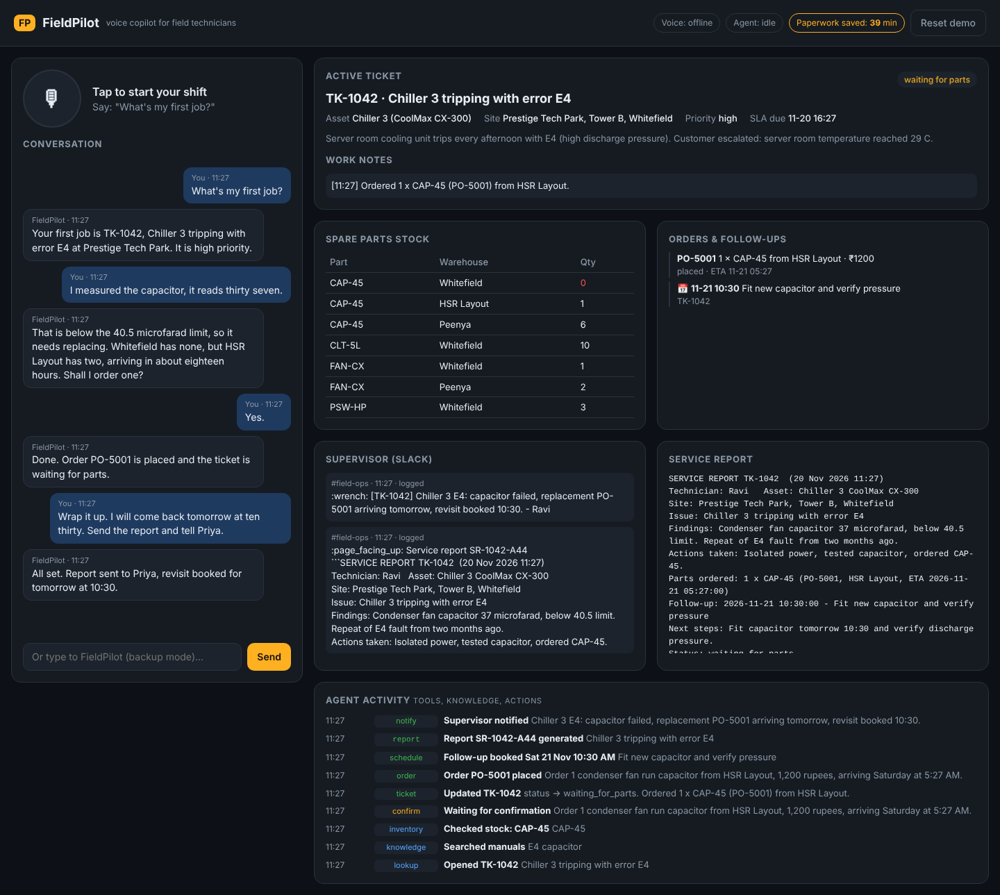

# HomePilot: the voice assistant that runs the family's day

> **Build with Agora, Bengaluru 2026** · Track **PS-1: Real-Time Conversational AI Meets Agentic Workflows** (AI Family Assistant)
>
> 🌐 **Live:** [fieldpilot-gu0j.onrender.com](https://fieldpilot-gu0j.onrender.com) · 🎙 **App:** [fieldpilot-gu0j.onrender.com/app.html](https://fieldpilot-gu0j.onrender.com/app.html) · 📞 **Join a family call:** [/expert.html](https://fieldpilot-gu0j.onrender.com/expert.html)
>
> 🎥 **Demo video:** [add link] · 📊 **Pitch deck:** [add link] · 👥 **Team SpeakX:** Lalit Kumar Singh

Anika just **talks**. HomePilot knows the family's calendar, chores and preferences. When the
living-room AC throws error E4 for the third time, it spots the repeat fault, walks her through a
safe check from the manual, finds a technician slot that **doesn't clash with Dadi's doctor visit**,
books it **only after she says yes**, puts it on the family calendar with a reminder, adds groceries
to the shopping list, asks Rohan to pick them up, reminds Dadi about her BP tablet, ticks off
Kabir's chore and sends everyone an update. It can even bring Rohan into the live voice call.

## Try it live

| Page | Link | What you'll see |
|---|---|---|
| Website | [https://fieldpilot-gu0j.onrender.com](https://fieldpilot-gu0j.onrender.com) | Call replay with waveform and agent trace, the “A day in the Sharma home” carousel, a live text console wired to the real agent, and the guardrails demo |
| Voice app | [https://fieldpilot-gu0j.onrender.com/app.html](https://fieldpilot-gu0j.onrender.com/app.html) | Tap the mic and talk: live family dashboard with calendar, chores, shopping list, reminders and the family channel |
| Family call | [https://fieldpilot-gu0j.onrender.com/expert.html](https://fieldpilot-gu0j.onrender.com/expert.html) | What a family member opens from Slack to join the live call |
| Health check | [https://fieldpilot-gu0j.onrender.com/api/diag](https://fieldpilot-gu0j.onrender.com/api/diag) | Models, voice settings and public URL status |

Hosted on Render's free plan: the first visit after a quiet period takes about 50 seconds to wake up. Click **Reset demo** in the app to start from the demo household.




## How it meets the problem statement

| PS-1 asks for | HomePilot |
|---|---|
| **Before:** retrieve schedules, pending tasks, preferences | `get_today` + a spoken **daily briefing** when the call starts: calendar, open chores, reminders, shopping list, household preferences (vegetarian, budget, quiet hours, Dadi's medicine) |
| **During:** understand priorities, coordinate by conversation | Contextual memory every turn (family, active issue, pending approvals). Appliance help from the **owner's manual (RAG)** plus **repeat-fault detection** from service history |
| **Action:** calendars, shopping lists, tasks, service requests via APIs | `find_service_slots` checks technicians **against the family calendar and quiet hours**; `book_service` (needs a spoken yes); `add_event`, `add_to_shopping_list`, `assign_task` (notifies the person on Slack) |
| **After:** reminders, completion tracking, follow-ups | Booking adds a calendar event and a reminder 30 minutes before; `set_reminder` / `cancel_reminder` (Dadi's medicine, alarms), `complete_task`, `daily_summary` posted to the family channel. **Reminders really ring**: a background clock fires them, the dashboard pops up with a chime, HomePilot **says them out loud in the live call** (Agora speak API) and posts them to the family channel |
| **Agora Conversational AI + RTC** | Agora agent in an RTC channel (speech-to-text, turn-taking, barge-in) calls our brain as a custom LLM. `call_family_member` brings **another family member into the same live call** from their phone |
| **Murf Falcon TTS** | Every reply spoken by Murf Falcon; a short filler covers tool calls so there is no dead air |
| **Tool calling, memory, external APIs** | 15 tools (also served over **MCP**), live context per turn, Slack webhook as the family channel |

## Safety and reliability
- **Human in the loop:** paid bookings and urgent alerts wait for an explicit "yes". **"No" is enforced in code**: if the last words were a refusal, the action is cancelled even if the model approves.
- **No double actions:** repeated sentences can't book twice, add duplicate items or re-send the summary.
- **Never invents times:** reminders and events only use a time the user actually said.
- **Natural turn-taking:** Agora semantic end-of-speech with pause detection, so a slow sentence or "hold on" isn't cut into several requests.
- **Honest about itself:** the assistant only describes features that exist; durations come from the tools, never from the model's arithmetic.
- **LLM failover:** instant switch across models and providers (Groq, Gemini) when one is rate-limited, slow or gone.

## Architecture

```
 Anika (browser mic, live family dashboard)        Rohan (phone, /expert.html)
        │  Agora RTC audio                               │  joins the same channel
        ▼                                                ▼
 Agora Conversational AI agent ── speech-to-text, turn-taking, interruptions
        │  OpenAI-format POST /chat/completions
        ▼
 HomePilot brain (FastAPI)
   ├─ brain.py       tool-calling loop, streamed replies, failover, speech cleanup
   ├─ memory         family, preferences, active issue, pending approvals (every turn)
   ├─ rag.py         search over appliance owner's manuals
   ├─ tools.py       14 household tools + confirmation gate + "no means no" guard
   └─ mcp_server.py  the same tools over MCP
        │
        ▼ reply text → Murf Falcon TTS (via Agora) → spoken answer
 Slack incoming webhook → #family channel
```

## Demo script

Open the website at `/` (hero, how it works, features, a live “Try it” box, an interactive safety demo), then **Open the app** (`/app.html`). Click **Reset demo**, then the mic. HomePilot opens with the day's briefing.

| Step | Anika says | What happens on screen |
|---|---|---|
| Before | "What's on today?" | Calendar, open chores, shopping list |
| During | "The living room AC is showing E four again and blowing warm air." | Blue **Repeat fault: E4 ×3** banner; one safe check from the manual |
| Action | "The outdoor fan isn't spinning. Can you get someone to fix it?" | Skips the slot that clashes with Dadi's doctor visit, prepares the best one → yellow approval banner |
| Confirm | "Yes." | Booking BK-7001, calendar event, reminder 30 minutes before |
| Action | "Add milk, paneer and Dadi's BP tablets to the shopping list, and ask Rohan to pick them up on his way home." | Shopping list + task for Rohan + Slack message |
| After | "Remind Dadi to take her BP tablet at 8 PM." | Reminder |
| After | "Kabir already took out the recycling." | Chore ticked off |
| After | "That's all. Send the family an update." | Family summary on Slack |
| Wow | "Get Rohan on this call." | Slack join link → Rohan joins the live call from his phone |

Safety moment: at the yellow banner say **"No, don't book it"**. Nothing is booked.

## Run it

```bash
python -m venv .venv
.venv\Scripts\activate            # Windows   (macOS/Linux: source .venv/bin/activate)
pip install -r requirements.txt
copy .env.example .env            # then fill in keys (macOS/Linux: cp)
python run_demo.py
```

`run_demo.py` starts a Cloudflare tunnel, passes its address to the server automatically, checks it
works and opens the app (needs `cloudflared`: `winget install --id Cloudflare.cloudflared`).
Without voice keys, the **text box** still runs the full assistant.

| Setting | Where to get it |
|---|---|
| `LLM_*` (+ optional `LLM2_*` failover) | Groq or Gemini key (free tiers work); any OpenAI-compatible API |
| `AGORA_APP_ID`, `AGORA_APP_CERTIFICATE` | Agora Console → Projects |
| `AGORA_CUSTOMER_ID`, `AGORA_CUSTOMER_SECRET` | Agora Console → RESTful API Keys |
| `MURF_API_KEY` | murf.ai → API dashboard |
| `SLACK_WEBHOOK_URL` (optional) | api.slack.com/apps → app → Incoming Webhooks |
| `BRAIN_API_KEY` | Any password you choose |

### Deploy online (Render, free)
Live deployment: **[https://fieldpilot-gu0j.onrender.com](https://fieldpilot-gu0j.onrender.com)**. It redeploys automatically on every push to `main`.

1. render.com → **New + → Blueprint** → pick this repo (it reads `render.yaml`).
2. Paste the secret values it asks for → **Apply**.
3. Open `https://<your-service>.onrender.com`. The public address is detected automatically.

Free instances sleep after about 15 minutes idle: open the link a minute before presenting.
Health check: `/api/diag`. See [DEMO_DAY.md](DEMO_DAY.md) before presenting.

## MCP and tests
```bash
mcp dev backend/mcp_server.py      # inspect the 14 household tools in MCP Inspector
pytest -q                          # 23 tests, no keys needed (the LLM is faked)
```

## Project layout
```
run_demo.py        one-command demo launcher (tunnel + server + browser)
render.yaml        one-click Render deploy
backend/
  main.py          HTTP API, /chat/completions for Agora, /api/state, /api/diag
  brain.py         prompt, live context, tool loop, streaming, failover, speech cleanup
  tools.py         household tools, confirmation gate, safety guards
  rag.py           manual search
  db.py            SQLite stand-in for calendar, tasks, shopping, appliance records, bookings
  agora.py         RTC tokens, start/stop the Conversational AI agent, Murf TTS config
  integrations.py  Slack webhook (family channel)
  mcp_server.py    MCP server over the same tools
  manuals/         appliance owner's manuals used for RAG
frontend/          index.html = website, app.html = voice panel + live dashboard, expert.html = join-the-call page
tests/
```

## What's next
- Real integrations: Google Calendar, WhatsApp, a grocery delivery API, Urban Company-style service booking.
- Hindi and Kannada voices for grandparents (`AGORA_ASR_LANGUAGE`, a Murf multilingual voice).
- Smart-home (IoT) hooks: read the AC's error code directly instead of asking.
- Proactive calls: HomePilot rings Dadi at 8 PM for her medicine and logs that she took it.
